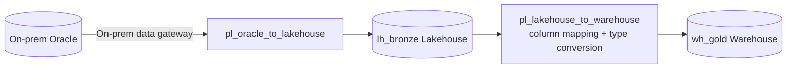

# Fabric CI/CD – Oracle → Lakehouse → Warehouse

A small GitHub Actions setup that uses [fabric-cicd](https://microsoft.github.io/fabric-cicd/) to deploy one Microsoft Fabric solution from Git to **TEST** and **PROD** workspaces. The jobs run on **self-hosted runners**.



| Data sinks and connections | Pipelines |
|---|---|
| On-prem Oracle connection (through the gateway) | `pl_oracle_to_lakehouse`: copies an Oracle table to `lh_bronze` |
| `lh_bronze` Lakehouse | `pl_lakehouse_to_warehouse`: copies and transforms data into `wh_gold.dbo.dim_customer` |
| `wh_gold` Warehouse | |

## Repository layout

```
.github/workflows/
  fabric-deploy.yml          # trigger: push to main -> TEST -> PROD (or manual run)
  fabric-deploy-env.yml      # reusable deploy job (self-hosted runner)
deploy/
  deploy.py                  # fabric-cicd publish + orphan cleanup
  requirements.txt           # fabric-cicd, azure-identity
workspace/                   # Fabric items (Fabric Git integration format)
  lh_bronze.Lakehouse/
  wh_gold.Warehouse/
  pl_oracle_to_lakehouse.DataPipeline/
  pl_lakehouse_to_warehouse.DataPipeline/
  parameter.yml              # replaces DEV IDs with IDs for the target environment
```

## How deployment works

1. When you push to `main` and the push changes `workspace/**`, `deploy/**`, or the workflows, the **TEST** deployment starts.
2. If TEST succeeds, **PROD** deploys next. Add required reviewers to the PROD environment to make this an approval gate.
3. Each deploy job creates a temporary Python venv on the runner, installs fabric-cicd, and runs `deploy/deploy.py`.
4. fabric-cicd publishes the Lakehouse and Warehouse first, then the pipelines. Fabric creates the Lakehouse and Warehouse as empty items with no definition. While publishing the pipelines, `parameter.yml` replaces the DEV workspace, item, and connection IDs with the target environment's values.
5. Pipelines that are no longer in Git are removed from the target workspace. **Lakehouses and Warehouses are never deleted**, which protects their data.

You can also deploy manually from **Actions → Fabric CI/CD → Run workflow** and choose TEST or PROD.

---

## Step-by-step implementation

### Step 1 – Create the Fabric workspaces
1. Create three workspaces on a Fabric capacity, for example `Sales-DEV`, `Sales-TEST`, and `Sales-PROD`.
2. Write down the **workspace ID** of TEST and PROD. It is the GUID in the URL: `https://app.fabric.microsoft.com/groups/<workspace-id>/...`.

### Step 2 – Create the service principal
1. In **Microsoft Entra ID → App registrations**, create an app such as `sp-fabric-cicd`, then create a **client secret**.
2. In the **Fabric Admin portal → Tenant settings**, turn on **Service principals can use Fabric APIs**. You can limit this setting to a security group that contains the service principal.
3. Add the service principal as **Contributor** or higher on the TEST and PROD workspaces.

### Step 3 – Set up the on-premises data gateway and Oracle connections
1. Install the **on-premises data gateway** on a server that can reach Oracle. Register the gateway to your tenant.
2. Install the Oracle client components that the gateway needs, as described in the Fabric Oracle connector docs.
3. In **Fabric → Settings → Manage connections and gateways**, create one **Oracle** connection on that gateway for each environment, such as `oracle-test` and `oracle-prod`.
4. Share each connection with the service principal (**User** role is enough). **fabric-cicd fails if the deploying identity cannot access a connection.**
5. Write down each **connection ID**. Open the connection's settings to find it.

### Step 4 – Build the items in DEV and sync them to Git
The files in `workspace/` are working templates. In practice, author the items in DEV and let Fabric Git integration write the definitions:

1. Connect `Sales-DEV` to this repository through **Workspace settings → Git integration**. Use branch `main` or a `dev` branch and the folder `workspace`.
2. In DEV, create `lh_bronze`, `wh_gold`, and the two pipelines. Use the Oracle connection in the Copy source.
3. Commit from Fabric. Fabric then overwrites or adds the files under `workspace/`.

> To keep the templates in this repository, import them into DEV with Git integration (**Update all**). Then open each pipeline and select your real Oracle connection, Lakehouse, and Warehouse.

### Step 5 – Update `parameter.yml` with your DEV IDs
Open the committed `pipeline-content.json` files. Replace each placeholder in `workspace/parameter.yml` (`find_value`) with the real DEV value from those files:

| Placeholder in repo | Replace with (from DEV) |
|---|---|
| `aaaaaaaa-0000-0000-0000-000000000001` | DEV workspace ID |
| `aaaaaaaa-0000-0000-0000-000000000002` | DEV `lh_bronze` item ID |
| `aaaaaaaa-0000-0000-0000-000000000003` | DEV `wh_gold` item ID |
| `aaaaaaaa-0000-0000-0000-000000000004` | DEV Oracle connection ID |
| `dev-placeholder.datawarehouse.fabric.microsoft.com` | DEV `wh_gold` SQL connection string |

You do not need to enter `replace_value` values by hand. fabric-cicd resolves them at deploy time:
- `$workspace.$id` resolves to the target workspace ID.
- `$items.Lakehouse.lh_bronze.$id` and `$items.Warehouse.wh_gold.$id` resolve to the IDs of the items in the target workspace.
- `$items.Warehouse.wh_gold.$sqlendpoint` resolves to the target Warehouse's SQL endpoint.
- `$ENV:ORACLE_CONNECTION_ID` uses the GitHub variable for that environment (Step 7).

### Step 6 – Prepare the self-hosted runner
On a Windows or Linux machine that has outbound HTTPS access to `login.microsoftonline.com`, `api.fabric.microsoft.com`, `api.powerbi.com`, and `pypi.org`:

1. Install **Python 3.10 or later** with the `venv` module (`python3-venv` on Debian or Ubuntu).
2. On Windows, install **Git for Windows**. The workflow steps use `shell: bash`.
3. In **Repo → Settings → Actions → Runners → New self-hosted runner**, follow the install commands. When `config` asks for labels, add the custom label **`fabric`**:
   ```bash
   ./config.sh --url https://github.com/<org>/<repo> --token <token> --labels fabric
   ```
4. Run the runner as a service: `./svc.sh install && ./svc.sh start` on Linux, or choose the service option during `config.cmd` on Windows.
5. If `python3` is not on the runner's PATH, set the repository variable `PYTHON_BIN` to the Python path, for example `C:\Python312\python.exe`.

> The runner does not need network access to Oracle. Oracle traffic goes through the data gateway, not through the runner.

### Step 7 – Configure GitHub environments, secrets, and variables
In **Repo → Settings → Environments**, create **`TEST`** and **`PROD`**. Make the names exactly match these. Add the following to **each** environment:

| Type | Name | Value |
|---|---|---|
| Secret | `AZURE_TENANT_ID` | Entra tenant ID |
| Secret | `AZURE_CLIENT_ID` | Service principal app (client) ID |
| Secret | `AZURE_CLIENT_SECRET` | Service principal secret |
| Variable | `FABRIC_WORKSPACE_ID` | TEST or PROD workspace ID |
| Variable | `ORACLE_CONNECTION_ID` | `oracle-test` or `oracle-prod` connection ID |

Recommended for **PROD**: add **Required reviewers** and restrict **deployment branches** to `main`.

### Step 8 – Run the first deployment
1. Commit and push to `main`, or open **Actions → Fabric CI/CD → Run workflow → TEST**.
2. Confirm that the log shows the Lakehouse, Warehouse, and both pipelines published to TEST.
3. In the TEST workspace, run `pl_oracle_to_lakehouse` first and then `pl_lakehouse_to_warehouse`. Check that `wh_gold.dbo.dim_customer` contains data.
4. Approve the PROD deployment.

### Step 9 (optional) – Test deploy.py locally
```bash
python -m venv .venv && . .venv/bin/activate     # Windows: .venv\Scripts\activate
pip install -r deploy/requirements.txt
export ENVIRONMENT=TEST FABRIC_WORKSPACE_ID=<id> ORACLE_CONNECTION_ID=<id> \
       AZURE_TENANT_ID=<id> AZURE_CLIENT_ID=<id> AZURE_CLIENT_SECRET=<secret>
python deploy/deploy.py
```

---

## Customizing
- **Oracle table:** change the `oracle_schema`, `oracle_table`, and `lakehouse_table` default values in `pl_oracle_to_lakehouse`. You can also pass these as parameters when you run the pipeline.
- **Transformation:** edit `translator.mappings` and `preCopyScript` in `pl_lakehouse_to_warehouse`. For more complex logic, replace the Copy activity with a Script or Stored Procedure activity on `wh_gold`.
- **More environments:** add a GitHub environment and another job in `fabric-deploy.yml`. Because `parameter.yml` uses `_ALL_`, it needs no changes.
- **Warehouse schema as code:** fabric-cicd creates the Warehouse with no tables, and the Copy activity creates the table automatically (`tableOption: autoCreate`). To manage DDL in Git, add a SQL database project and deploy it with `sqlpackage` in an extra workflow step.

## Troubleshooting
| Symptom | Fix |
|---|---|
| `Missing required environment variable` | Check the secret or variable names in the GitHub environment. They are case-sensitive. |
| 401 or 403 from the Fabric API | The service principal tenant setting is off, or the service principal is not a workspace member. |
| Pipeline publish fails with a connection error | Share the Oracle connection with the service principal (Step 3.4). |
| Pipeline still points to the DEV Lakehouse or Warehouse | A `find_value` in `parameter.yml` does not match the ID in `pipeline-content.json`. |
| Job stays queued | No online runner has the `self-hosted` and `fabric` labels. |
| `python3: command not found` | Set the `PYTHON_BIN` repository variable (Step 6.5). |
